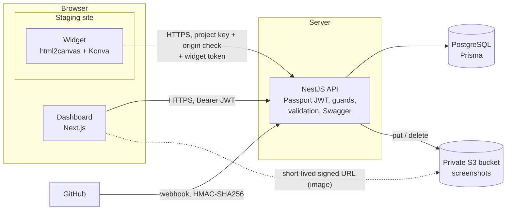
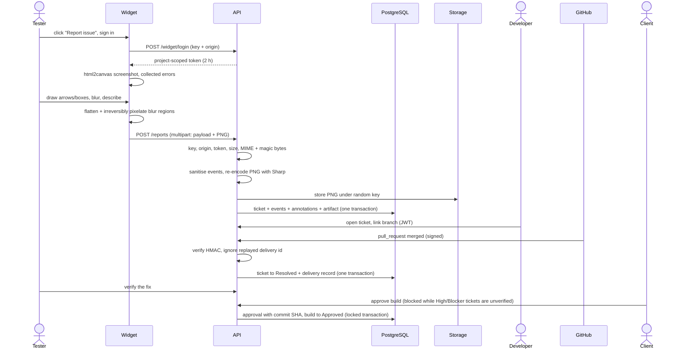
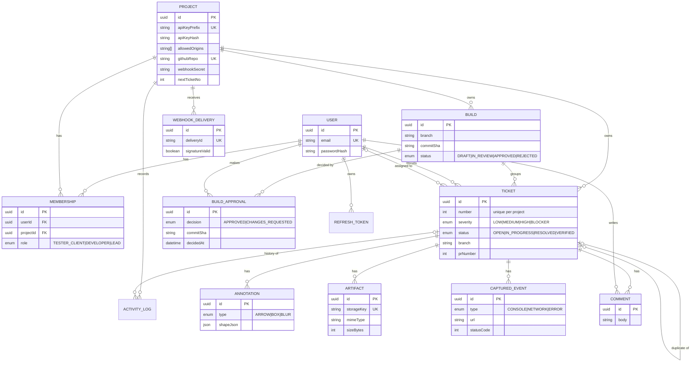

# Architecture

InspectFlow is a three-tier web application (proposal section 12). The dashboard and the embeddable widget both talk to one NestJS REST API, which reads and writes PostgreSQL and a private S3-compatible bucket. GitHub calls the API through a signed webhook.

## System diagram



## Report-to-approval sequence



## Entity relationship diagram

Matches [apps/api/prisma/schema.prisma](../apps/api/prisma/schema.prisma). `RefreshToken` and `ActivityLog` are supporting tables not listed in the proposal.



Key constraints: `Membership (userId, projectId)` unique; `Ticket (projectId, number)` unique; `WebhookDelivery.deliveryId` unique (replay protection); `Project.apiKeyPrefix` and `githubRepo` unique. Deleting a project cascades to everything it owns; deleting a build only clears `Ticket.buildId`; users referenced by tickets, comments or approvals cannot be deleted (`RESTRICT`) so the audit trail stays intact.

## Request pipeline (API)

```
request
  -> Helmet, CORS (dashboard origins; widget routes answer any origin, then check per project)
  -> RequestLoggerMiddleware (method, path, status, duration; no query strings)
  -> JwtGuard            (global; skipped for routes marked @Public)
  -> ProjectRolesGuard   (global; any route with :projectId needs membership, @ProjectRoles narrows it)
  -> ThrottlerGuard      (rate limits; stricter on login and widget routes)
  -> ValidationPipe      (whitelist + forbidNonWhitelisted, class-validator DTOs)
  -> controller -> service -> Prisma / storage
  -> TimingInterceptor   (X-Response-Time)
  -> AllExceptionsFilter (one error shape, no stack traces, Prisma errors mapped to 404/409)
```

## Folder structure

```
inspectflow/
  apps/
    api/                          NestJS backend
      prisma/                     schema.prisma, migrations/, seed.ts
      src/
        main.ts, app.module.ts, app.setup.ts, app.controller.ts (health)
        config/                   Zod-validated environment
        common/                   decorators, guards, filters, interceptors, middleware, utils
        providers/                database (Prisma), storage (local + S3)
        modules/
          auth/ users/            registration, login, refresh, profile
          access/                 ProjectAccessService + ProjectRolesGuard (permissions)
          projects/               projects, members, widget key, GitHub connection, overview
          builds/                 builds and client approval
          tickets/                tickets, workflow rules, comments
          reports/                widget endpoints (key + origin guard, login, ingest)
          files/                  image validation, signed local files, retention
          github/                 webhook handling
          activity/               activity history and audit log
      test/                       integration tests and helpers
    web/                          Next.js dashboard (App Router)
      src/app/                    pages; src/components/ui.tsx; src/lib/ (api, auth, types)
    widget/                       embeddable widget (collector, editor, redaction, UI)
    staging/                      demo shop with deliberate defects
  scripts/                        demo-flow.mjs, local-db.ps1
  docs/                           this documentation
```

The layout follows the instructor's `user-management` project: modules with controller, service and DTOs, `common/` for guards, decorators and filters, `config/` for environment, `providers/` for infrastructure, and `@/` path aliases.
